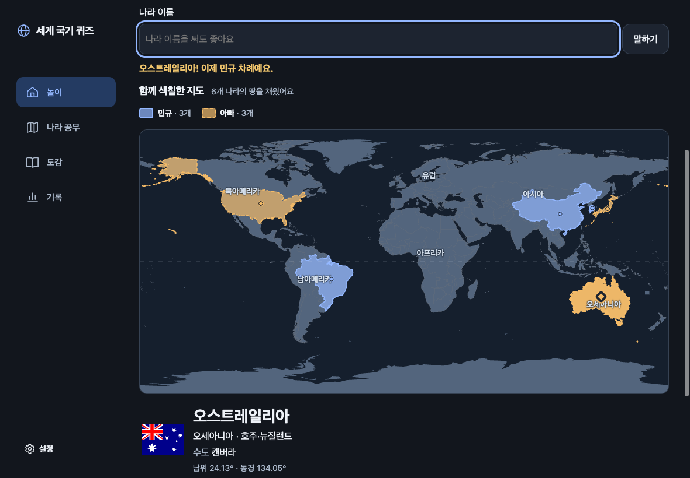
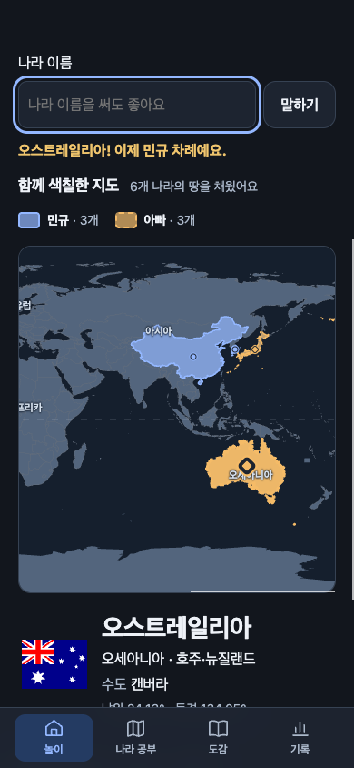
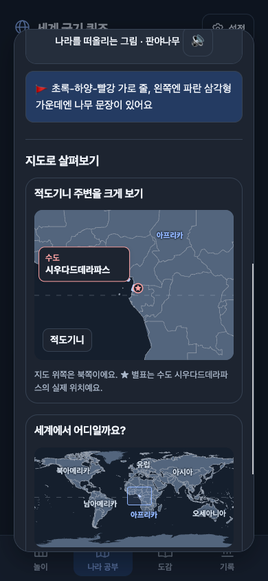

# 국가 영역·수도·두 사람 게임 검증 — 2026-10-13

## 구현

`map_render`·`map_data`·`map_ux`·`map_validation` 네 에이전트가 렌더링·데이터·사용성·검증을 분담하고 root가 앱 연결과 실제 브라우저 검사를 진행했다.

- 앱에 포함된 194개 나라의 경계 안 전체를 색칠한다. 부속섬·내륙 구멍·날짜변경선을 보존하며 바티칸·산마리노·레소토를 이웃 나라로 덮지 않는다.
- 생성 지도는 548,444바이트다. 수도 주변 해안 정밀화와 19개국의 공식 10m 경계 보정을 적용했다. 기존 배경 육지·저장 형식·학습 기록·음원 캐시는 유지한다.
- 홈과 메뉴의 나라 공부에서 194개국을 검색·대륙 필터로 찾고 국기·큰 수도·듣기·대표 그림·상식·국가 영역을 본다.
- 수도는 국가 대표점과 분리한 실제 도시 좌표다. 지역 지도·작은 나라 확대창에 별표와 이름을 표시하며 퀴즈 보기에는 숨긴다. Natural Earth 191개·NGA 3개를 이름·국가·도시 ID·SHA로 연결했다.
- 193개 수도는 자기 나라 영역 안에 있다. 니코시아는 원자료 도시점이 UN 완충지대에 놓인 출처 예외를 명시하고 좌표를 옮기지 않는다.
- 적도기니는 [정부의 2026-01-02 공식 발표](https://www.guineaecuatorialpress.com/index.php/noticias/el_presidente_de_la_republica_proclama_la_ciudad_de_la_paz_como_capital_de_la_republica_de_guinea_ecuatorial_con_la_firma_de_un_decreto_ley)에 따라 시우다드데라파스로 보정하고 새 Sua 음원 한 개를 추가했다.
- 두 사람 게임은 이력의 소유자에 따라 파랑·실선과 주황·점선으로 영역을 누적한다. 이름·개수 범례와 마지막 선택 강조, 작은 나라의 44px 보조 입력을 함께 제공한다.

## 자동 검사

| 실행 | 결과 |
| --- | --- |
| `npm test` | 자료 10,041건, Node 1,133/1,133 통과, 실패·건너뜀 0. [전문](tests.txt) |
| `npm run verify -- --deep --strict` | 42/42 통과, 실패 0, 미구현 0. [전문](verify-deep.txt) |
| `FQ_REQUIRE_ART=1 npm run build` | 성공. Sua 1,319개·음악 16개, 누락 0. [전문](build.txt) |

원자료 없는 격리 사본에서도 생성 자료·투영·국가 경계 검사를 실행한다. 원자료 SHA·도시 ID·재생성 대조만 원자료가 있을 때 추가한다. 194개국의 양쪽 소유자·도형·섬·구멍, 중복·차례·초기화·상세 선택과 기존 음성 차례 흐름을 회귀 검사한다.

## 실제 브라우저 게임

로컬 미리보기에서 실제 홈 버튼·입력칸·Enter·새로 하기 버튼으로 검사했다. 게임 엔진을 직접 호출해 나라를 넣지 않았다. 읽어주기는 격리된 검사 브라우저에서 껐으며 실제 계정·학습 기록·설정은 바꾸지 않았다.

| 차례 | 입력 | 소유자 | 점수 |
| --- | --- | --- | --- |
| 1 | 대한민국 | 민규·파랑 | 1:0 |
| 2 | 일본 | 아빠·주황 | 1:1 |
| 3 | 중국 | 민규·파랑 | 2:1 |
| 4 | 미국 | 아빠·주황 | 2:2 |
| 5 | 브라질 | 민규·파랑 | 3:2 |
| 6 | 호주 | 아빠·주황 | 3:3 |

매 입력 후 이전 나라의 소유자·색·SVG 경계가 유지되고 새 영역 하나만 추가됨을 DOM과 화면으로 확인했다. [입력별 기록](browser-game-evidence.json).

- 한국 재입력: 중복 안내, 6개·점수 3:3·민규 차례 유지.
- 없는나라 / 캐나다 프랑스: 잘못된 입력 안내, 색·점수·차례 유지.
- 나라 정보 선택: 상세·강조만 바뀌고 누적 6개와 소유자 색 유지.
- 390×844 모바일 뷰에서도 같은 6차례, 양쪽 3개씩, 배경 경계 194개, 보조 입력 44×44px, 페이지 가로 넘침 없음.
- 새로 하기: 색칠 0개·점수 0:0·이력 0개·첫 사람 차례. 프랑스 → 캐나다로 파랑·주황 각 1개가 다시 쌓임. [초기화 기록](browser-reset-evidence.json).
- 한국 영역에 일본의 투명 보조 버튼이 겹친 실제 픽셀 (1019, 355)을 마우스로 클릭하면 대한민국이 선택됨. 일본의 보이는 점 중심은 일본, 한국 보조 버튼의 Enter는 대한민국을 열고 점수·차례·색 유지. [선택 보정 기록](browser-selection-evidence.json).
- 320×568, 공백 없는 20자 이름 두 개에서도 범례가 줄바꿈되고 페이지 너비 320px 유지.

## 나라별 공부와 수도

실제 검색창에서 시우다드데라파스를 검색해 적도기니 한 나라가 나오는 것을 확인했다. 상세 지도 별표는 NGA 도시점 [10.823611, 1.5925]와 일치했다. 대한민국은 서울을 표시하며 Escape로 닫으면 원래 카드 초점과 본문 스크롤이 복원됐다. 390px 화면에서 상세·수도·지도에 페이지 가로 넘침이 없었다.

## 확인 범위

로컬 구현과 실제 Chromium 게임의 글자 입력·마우스·키보드·화면 검증까지 완료했다. 실제 iPad/iPhone Safari/PWA, 실제 마이크·NAS 음성 인식, 운영 배포·커밋·푸시는 수행하지 않았다. 기존 작업 트리의 변경은 보존했다.
